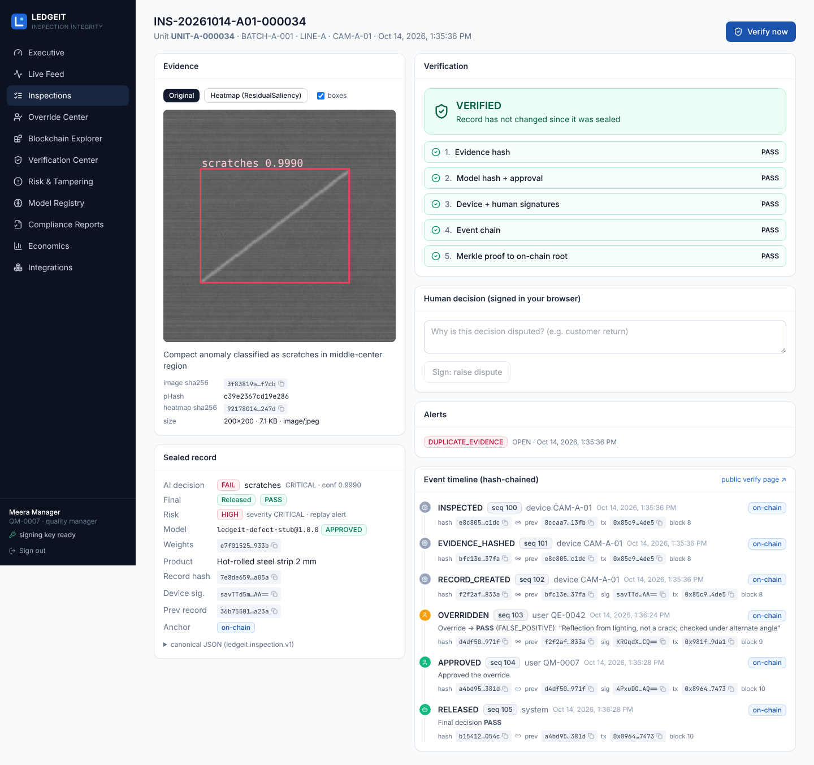
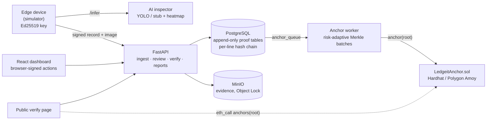
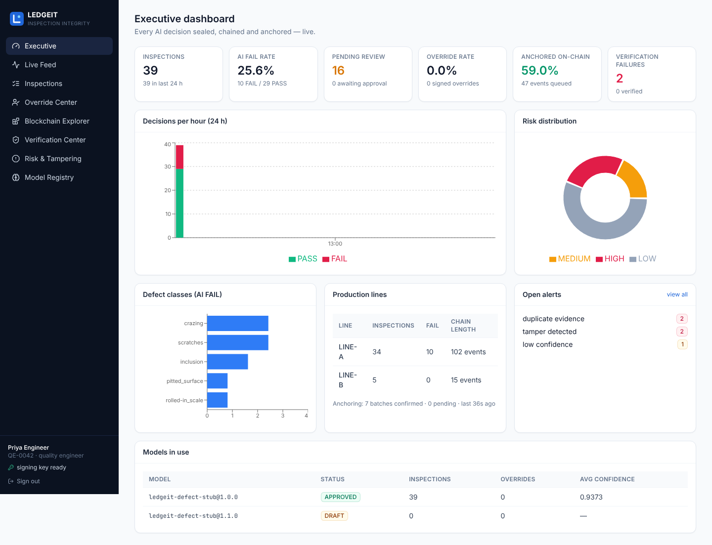
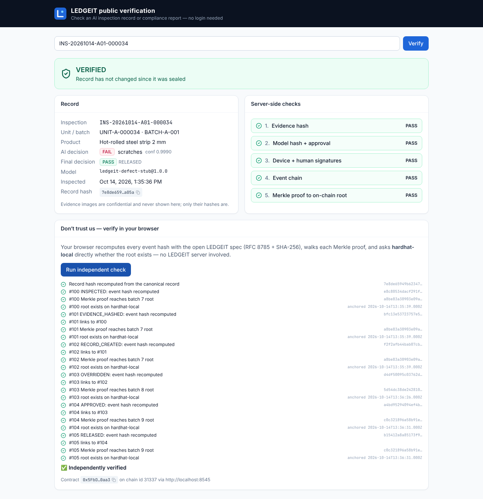

# LEDGEIT

**A cryptographically verifiable chain of custody for every AI manufacturing decision.**

Factories let AI inspect every product, but the record of what the AI saw and decided is usually an ordinary database
row that anyone with access can change later (Kobe Steel, Mitsubishi Materials, Global Calcium, Nidec…).
LEDGEIT binds **Evidence + Model + Decision + Explanation + Human Response + Timestamp** into one signed,
hash-chained record, anchors it on a public ledger, and lets *anyone* re-verify it later. One changed byte → mismatch.

> MIT-ADT University · Dept. of CSE · Group LYBCC51 · Guide: Dr. Shraddha Phansalkar
> Team: Ishan Shrivastava · Chaitanya Pagare · Aryan Kale



## The six stages

| Stage | What happens | Code |
|---|---|---|
| 1 Detect | Edge camera runs the AI model → decision, class, severity, confidence, boxes, heatmap | `services/ai-inspector`, `services/edge-simulator` |
| 2 Bind | Image hash + model weights hash + result + explanation sealed as RFC 8785 JSON, **signed by the device** | `packages/proof-core`, `POST /inspections` |
| 3 Anchor | Every event is chained per production line; Merkle roots go on-chain — routine ones batched, critical ones immediately | `services/anchor-worker`, `contracts/` |
| 4 Respond | Human review / override / approval / dispute, **signed in the browser** (Ed25519) and chained | `apps/web`, `human/router.py` |
| 5 Verify | 5 independent checks: evidence, model, signatures, event chain, Merkle proof → on-chain root | `verification/engine.py` |
| 6 Report | Audit PDFs with a QR code; a public page re-verifies — even in the visitor's own browser | `reports/`, `/verify/:code` |

## Architecture



Full design: [`docs/team/CHAITANYA.md`](docs/team/CHAITANYA.md) · integrity spec: [`packages/proof-core/SPEC.md`](packages/proof-core/SPEC.md) ·
decisions: [`docs/adr/`](docs/adr/) · threat model: [`docs/architecture/threat-model.md`](docs/architecture/threat-model.md) ·
status: [`docs/STATUS.md`](docs/STATUS.md)

## Quick start

### Option A — Docker
```bash
cp .env.example .env
make up                                         # postgres, minio, hardhat, api, worker, ai-inspector, web
docker compose -f infra/docker-compose.yml exec api python -m ledgeit_api.db.seed
docker compose -f infra/docker-compose.yml --profile demo up edge-simulator   # stream inspections
open http://localhost:5173
```

### Option B — native (no Docker; Postgres 16 + Python 3.11+ + Node 20)
```bash
cp .env.example .env            # set STORAGE_BACKEND=local unless MinIO is running
make install                    # .venv + npm deps
make seed                       # migrate + demo plant, lines, devices (keys), users, models
make dev-start                  # hardhat node, ai-inspector :8001, api :8000, worker, web :5173
make simulate                   # stream 30 inspections
make demo                       # scripted end-to-end story with assertions (see below)
```

Demo users — password `ledgeit123`: `qe@` (Quality Engineer), `qm@` (Quality Manager), `auditor@`, `operator@`, `admin@` `ledgeit.dev`.

## The demo (`make demo`, ~10 s)

```
1. Live line         14 + 3 inspections signed by two edge devices (regulated line is always HIGH risk)
2. Anchor            Merkle batches per risk level confirmed on-chain → record VERIFIED (5/5 checks)
3. Respond           QE signs an override FAIL→PASS in the browser key, QM signs the approval → VERIFIED
4. Attack (DBA)      T1 flip decision → signature+chain FAIL · T2 swap image → evidence FAIL · T3 delete event → chain FAIL
5. Smart insider     re-sign + recompute every hash, proof and root → only check 5 FAILS: the chain cannot be rewritten
6. Replay            old image as a new unit → DUPLICATE_EVIDENCE, forced HIGH
7. Report            PDF + QR; public page shows FAILED for the tampered batch
8. Economics         real fees, cost per inspection, ~90% saved by batching
```

Attack tools: [`scripts/tamper-lab/`](scripts/tamper-lab/README.md).

| | |
|---|---|
|  |  |

## Repository layout

```
apps/api            FastAPI: ingest, hash chain, review/override, verification, reports, economics (+ anchor worker core)
apps/web            React dashboard + public verify page
packages/proof-core SPEC.md + Python + TypeScript implementations + shared test vectors
contracts           LedgeitAnchor.sol, Hardhat tests, deploy scripts, ABI, deployments/
services/           ai-inspector · edge-simulator · anchor-worker
scripts/            dev.sh · demo.py · tamper-lab/ · reset_db.py
config/             risk.yaml (thresholds, batching windows) · economics.yaml
infra/              docker-compose, MinIO object-lock init, reference schema.sql
docs/               adr/ · api/openapi.json · architecture/ · team/ · progress/ · references/
```

## Tests

`make test` runs everything (Postgres needed for the API suite; `TEST_DATABASE_URL` defaults to `…/ledgeit_test`):

| Suite | Tests |
|---|---|
| proof-core Python / TypeScript (same vectors) | 10 / 6 |
| API (ingest, anchoring, human actions, verification + all attacks, reports, economics) | 48 |
| AI inspector | 5 |
| Contracts (Hardhat) | 7 |
| Web (in-browser verifier, key store, components) | 5 |

## Honest limits
See the [threat model](docs/architecture/threat-model.md#known-limits-say-these-in-the-viva): the pre-anchor window,
MVP key custody (browser IndexedDB / key files), and that `CHAIN=local` is operator-controlled — the public-ledger
claim requires `CHAIN=amoy`. The stub model is a classical-CV baseline; YOLO weights must be trained (see
[`services/ai-inspector/MODEL_CARD.md`](services/ai-inspector/MODEL_CARD.md)).

## License
MIT
